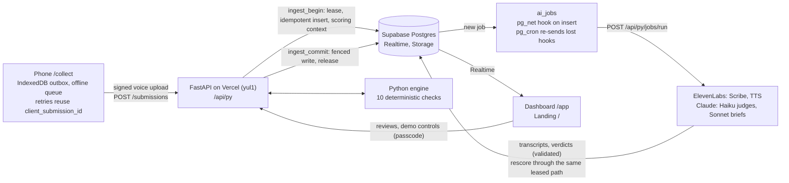

# Field QA Copilot

Field QA Copilot checks every field-survey submission as it syncs from a phone and flags likely fabrication, such as forms filled in at a tea shop, copied answers or one phone used for several accounts. Each flag comes with evidence a reviewer can check. Ten deterministic checks score each submission, model verdicts (speech to text, voice-vs-form meaning, reworded copies) feed in as extra inputs, flagged items land in a review queue, and the lead researcher gets a written morning brief. It is an interview prototype for Poket Inc, built on a seeded synthetic survey wave (Kisumu, Kenya) with planted fraud, so every number below can be checked against ground truth.

## Live

| | |
|---|---|
| Landing | https://field-qa-copilot.vercel.app |
| Dashboard (overview, review queue, detectors, test a submission) | https://field-qa-copilot.vercel.app/app |
| Phone collect page (open it from the QR code in the demo panel: press D on the dashboard) | https://field-qa-copilot.vercel.app/collect |
| API docs | https://field-qa-copilot.vercel.app/api/py/docs |
| Hard-mode evaluation (rules only vs rules + AI) | https://field-qa-copilot.vercel.app/api/py/eval/hard |

Preview deployments are read-only views of the same database (`WRITES_ENABLED` is true on Production only).

## Architecture



- **Ingest** is two database calls. `ingest_begin` takes leases on every contributor and device the arrival can affect, inserts the submission idempotently and returns the scoring context. `ingest_commit` writes the results only while the leases still hold. SQL fetches and writes; every check and scoring decision is Python.
- **Model work** is queued after the commit and never awaited. The database posts each new job to the API; a cron sweep re-sends deliveries that never arrived. A verdict is stored as an input that a check reads, and with no verdict the rule stands.
- **The UI** reads with the publishable key and refreshes on Realtime events, never by polling.

## Key numbers

| | |
|---|---|
| Held-out precision / recall (seeds 101–110, review threshold 2.0) | **88.9%** (87.0–90.3%) / **99.3%** (97.9–100%) |
| Hard mode, held-out seeds 201–202: rules only | precision 86.9%, recall 71.7% |
| Hard mode: rules + AI verdicts | precision **91.5%**, recall **86.9%** |
| Hard mode's night forger (phone clock set back 3 h): night forms missed per wave | 6.5 without clock_skew, **0** with it |
| Ingest `POST /submissions` on production | p50 188 ms, p95 254 ms (2 database calls) |
| Phone, from tapping Submit (12 production runs) | rules result 1.9 s, transcript 4.5 s, model verdict 6.7 s (medians) |
| Model latency per call (production jobs) | judge p50 1.35 s (Haiku), transcription p50 0.53 s (Scribe), brief p50 7.5 s (Sonnet) |
| Model spend on production, all time | $0.72 over 3,656 jobs (the wave backfill included) |
| Hard-mode model verdicts (recorded once, replayed by CI for free) | 6,953 verdicts, $1.16 |

Where the numbers come from: `scripts/evaluate.py` (held-out seeds and hard mode), the `ai_jobs` table (latency and spend), and the round 5 and round 8 timing runs (ingest and phone).

## Run it locally

```bash
pnpm install
uv sync
cp .env.example .env.local   # then fill in the values
git config core.hooksPath .githooks
pnpm dev                     # Next.js on :3000, FastAPI on :8000
curl http://localhost:3000/api/py/health
```

`.env.local` needs the Supabase URL, publishable key and service role key, `DEMO_PASSCODE`, and, for the model features, `ANTHROPIC_API_KEY` and `ELEVENLABS_API_KEY`. Without the model keys every check still runs and model jobs are skipped.

## Tests and evaluation

```bash
uv run pytest                                   # Python: engine, API, AI layer (faked), edge cases
pnpm typecheck && pnpm lint
pnpm test:smoke                                 # Playwright desktop tests against the local app
pnpm exec playwright test --project=pixel --project=iphone   # the phone page, fake microphone
uv run scripts/evaluate.py --min-precision 0.85 --min-recall 0.97   # held-out gate, as CI runs it
uv run scripts/evaluate.py --hard               # rules only vs rules + AI, from recorded verdicts
uv run scripts/refresh_ai_verdicts.py --estimate   # after a prompt or model change: what re-recording costs
uv run scripts/gen_edge_cases.py --estimate     # propose new edge cases for review (model calls)
uv run scripts/verify_wave.py                   # after a demo reset: the database is the fresh wave
```

CI (`.github/workflows/ci.yml`) runs pytest offline with no keys, the web build, the held-out gate, hard mode from the recorded verdicts and the attribution guard on every PR. It also posts one comment per PR comparing precision and recall with main. After each Production deployment, `post-deploy.yml` runs the browser tests against production, resets the demo and runs `verify_wave.py`.

## More

- [docs/ai-practices.md](docs/ai-practices.md): how AI is used here, as a guide a team could adopt.
- [docs/decisions.md](docs/decisions.md): the key design decisions and why.
- [CLAUDE.md](CLAUDE.md): the project guide (layout, conventions, every script).
